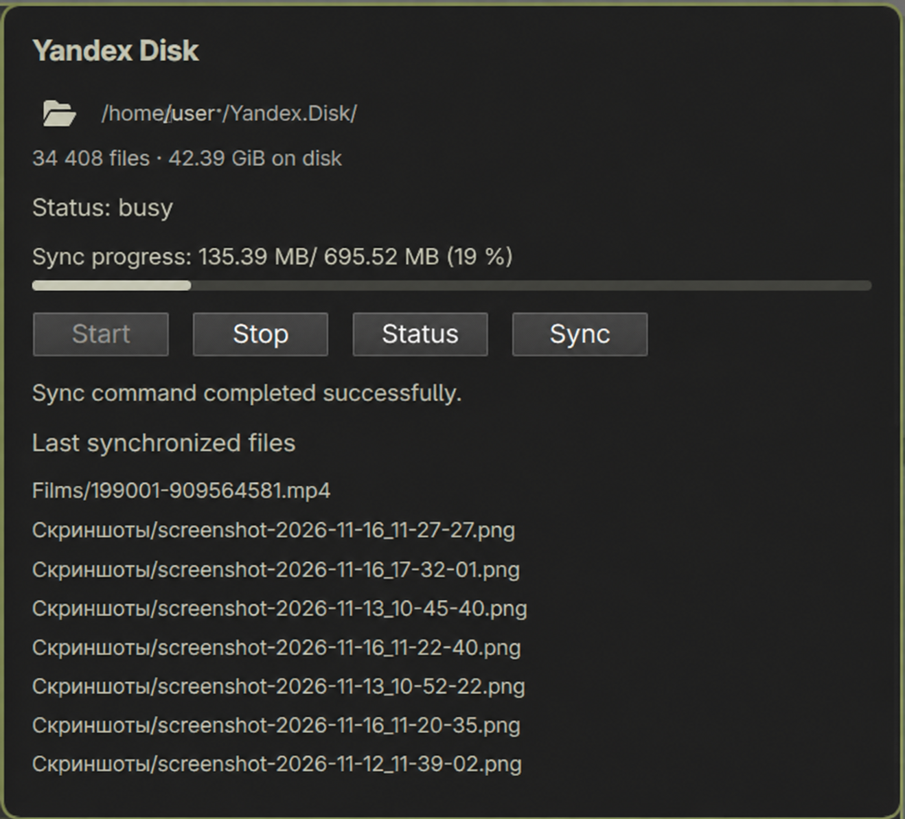

# omarchy-yandex-disk

A minimal Yandex Disk integration for the Omarchy bar.

## Screenshots

### Bar widget


### Synchronization progress



## Features

- Displays the daemon status in the bar.
- Refreshes the status every 5 seconds.
- Opens a popup with Start, Stop, Status, and Sync controls.
- Allows manual Stop when the reported status is `unknown`.
- Attempts one automatic Stop -> Start recovery per widget instance after
  three consecutive `unknown` status responses.
- Displays synchronization progress and recent synchronized files when
  reported by the client.
- Displays the synchronization directory reported by the client.
- Shows the number of local files and local disk usage.
- Refreshes directory statistics every 5 minutes, when the directory changes,
  and after the Sync command exits.
- Displays status messages, directory statistics errors, and daemon control
  errors in the popup.
- Uses the official Yandex Disk CLI directly, without systemd integration.
- Uses the Omarchy theme foreground color for the main interface and gray
  text for directory information.
- Offers an Install button when the Yandex Disk CLI is not found.
- Opens an interactive AUR installer in a terminal using yay.

## Requirements

- Omarchy with shell plugin support.
- Python 3.
- The official `yandex-disk` CLI for status monitoring and daemon controls.
- GNU `du` for local disk usage statistics.

If the client is missing, the popup offers an Install button. Installation
requires `yay` and `omarchy-launch-terminal`.

The installer runs `yay -S --needed aur/yandex-disk` in a separate terminal,
without `--noconfirm`. Review the AUR build files and installation prompts
before proceeding.

Account authorization and initial client configuration must be completed
separately. The installer does not configure an account, start the daemon,
or change autostart settings.

## Installation

```bash
omarchy plugin add https://github.com/toxusa/omarchy-yandex-disk.git --enable
```

To update an installed copy:

```bash
omarchy plugin update toxusa.yandex-disk
```

If the widget does not appear or still shows the previous version after an
update, restarting the shell helped during development:

```bash
omarchy restart shell
```

## Usage

Click the bar widget to open the popup.

- Start is available when the daemon is stopped.
- Stop is available when the reported status is `idle`, `busy`, `index`,
  or `unknown`.
- Start and Stop are disabled while a daemon control or Sync command is running,
  or while automatic recovery is in progress.
- Status requests an immediate status refresh.
- Sync runs `yandex-disk sync` and reports the command result in the popup.
- Sync is available when the daemon reports `idle`, `busy`, or `index`,
  and no daemon control, Sync command, or automatic recovery is in progress.
- Regular status changes may take up to one polling interval to appear.

Stopping the daemon interrupts synchronization. Use Start to resume it.

### Automatic recovery from unknown status

`unknown` means that the status adapter could not recognize the client's
status response. It does not necessarily mean that the daemon has stopped
or is malfunctioning.

After three consecutive `unknown` status responses, the widget attempts
one automatic recovery:

1. Run `yandex-disk stop`.
2. Require successful completion of Stop and a fresh status response
   confirming `stopped`.
3. Run `yandex-disk start`.
4. Require successful completion of Start and a status response reporting
   `idle`, `busy`, or `index`.

A different status breaks the consecutive `unknown` sequence. Recovery
does not begin while a daemon control command, Sync, or the installer
launcher is running.

Start is not issued if Stop fails, times out, or is not confirmed by a
fresh `stopped` response. Status requests started before the Stop command
cannot authorize Start.

Start, Stop, Sync, and Install are blocked throughout automatic recovery,
including the intervals between commands. Status polling continues.

The widget waits up to 30 seconds for each status confirmation after
the corresponding command succeeds. Start and Stop also retain their
individual command timeouts described below.

The popup displays recovery progress and the result. If recovery fails,
the widget shows an error and does not automatically retry. Even after
successful recovery, another sequence of `unknown` responses does not
trigger a second automatic restart in the same widget instance.

The one-attempt limit resets when the widget instance is recreated, for
example after a shell restart. It is not a persistent limit across shell
sessions, and each widget instance has its own limit.

A normal manual Stop does not schedule an automatic Start. Automatic
recovery temporarily interrupts synchronization, just like a manual
Stop followed by Start.

### Client installation

When the CLI is not found, Start and Stop are replaced by an Install button.
Click Install to open the installer terminal. The installer asks for
confirmation before invoking yay and waits for Enter before closing.

Status polling continues while the installer is open. Once the CLI becomes
available, the widget returns to the normal status and control view.
Installing the package alone does not authorize or configure the client.

### Messages and daemon control timeouts

Status messages and daemon control errors are displayed separately in the
popup. A control error is cleared before the next control or installation
attempt. A status message is replaced on each status response and cleared
when that response has no message.

Daemon control commands have a 15-second timeout. If a command is still
running, the widget sends SIGTERM, followed by SIGKILL after another
3 seconds if necessary.

A timeout message remains visible until the next control or installation
attempt. After the control process exits, the widget requests the actual
client status. A timeout does not necessarily mean that the requested
action had no effect.

This timeout applies only to Start and Stop, not to Sync or the interactive
installer.

### Synchronization details

The popup displays progress information and recent synchronized files when
these are included in the client's status response. Progress information
may be unavailable even while the client reports `busy`.

### Local directory statistics

The synchronization directory is taken from the client's status response;
it is not hardcoded.

Below the directory path, the popup displays a line such as:

```text
34 408 files · 42.39 GiB on disk
```

Statistics are collected in the background:

- When the reported synchronization directory changes.
- Every 5 minutes while a directory is known.
- After the Sync command exits, whether it succeeds or fails.

The regular 5-second status poll does not trigger a directory scan.

Previous values remain visible while statistics for the same directory
are refreshed. Changing the directory clears the previous values, and
results from an outdated directory request are ignored.

If an update fails, the popup displays an error. Any previous values for
the same directory remain visible and may be outdated.

The file count includes regular files, including hidden files. Symbolic
links are not counted as regular files and are not traversed. The root
`.sync` entry is excluded; nested user directories named `.sync` are not
excluded.

Disk usage is measured with GNU `du` and represents allocated disk space,
not the sum of apparent file sizes or cloud storage usage. It can include
space allocated to directories and symbolic links. Sizes are displayed
in GiB (1 GiB = 1,073,741,824 bytes).

The adapter uses a shared 30-second timeout budget for the directory scan
and disk usage command.

## Status adapter

To query the status independently of the widget:

```bash
python3 yd-status.py
```

The adapter prints one JSON object with a `state` field:

- `not_installed`
- `stopped`
- `idle`
- `busy`
- `index`
- `unknown`
- `error`

Additional fields provide the synchronization directory, progress, recent
files, or a status message when available.

The adapter only reads the status. It does not change client configuration.

## Directory statistics adapter

To query local directory statistics independently of the widget:

```bash
python3 yd-directory-stats.py "/path/to/Yandex.Disk"
```

On success, the adapter prints one JSON object containing:

- `state`: `ok`
- `sync_dir`: the absolute directory path
- `file_count`: the number of regular file paths
- `disk_bytes`: allocated disk space in bytes

On failure, it returns `state: "error"` and a `message`, without partial
file count or disk usage values.

## Current limitations

- Account authorization and initial client configuration must be completed
  separately.
- Installation requires yay and the Omarchy terminal launcher.
- Installation progress and results are shown in the terminal, not in the
  popup. The widget does not track the package manager's exit status.
- Daemon control errors show a generic message with an exit code or an
  abnormal termination message. Detailed command output is only logged.
- Failure to start a control process is not explicitly handled.
- Sync has no plugin-defined timeout.
- Progress and recent file information depend on the client's status output.
- Cloud storage quota is not displayed.
- Directory statistics are snapshots, not live counters. The file scan and
  disk usage query are separate operations and may observe different
  contents while synchronization is running.
- Each widget instance performs its own status polling and statistics scans.
  Automatic recovery is also instance-local; multiple instances do not
  coordinate recovery attempts.
